<picture>
  <source media="(max-width: 640px)" srcset="https://raw.githubusercontent.com/dovlet808/dovlet808/main/assets/header-mobile.svg">
  
</picture>

 

Hi, I'm **Dovlet Halykov**, a developer from Turkmenistan based in Malaysia. I build practical digital products end to end: the design system, the code, and the server it runs on. I learn by shipping real things and debugging them until they actually work.

  <a href="#featured-projects">Projects</a> ·
  <a href="#tech-stack">Tech stack</a> ·
  <a href="#current-focus">Current focus</a> ·
  <a href="#contact">Contact</a>

## About me

- **Websites and web applications.** Product catalogues, admin panels, multilingual content, SEO and forms that resist spam, built with PHP and Laravel or with plain PHP and vanilla JavaScript when a framework is not needed.
- **Automation.** Python tools that take repetitive work off people: Telegram bots, SSH and SFTP orchestration, and browser automation.
- **Servers and hosting.** Linux administration, firewalls, DNS, TLS, hosting panels, and release packaging that checks itself before anything is uploaded.

I completed the **Foundation in Computing at Taylor's College, Malaysia**. Most of what I know beyond that comes from building and running real projects, and from writing down what broke and why.

## Featured projects

<!-- To feature a new project: add its preview to assets/projects/ and copy one of the blocks below. -->

<a href="https://github.com/dovlet808/mikrotik-ashgabat-website-concept">
  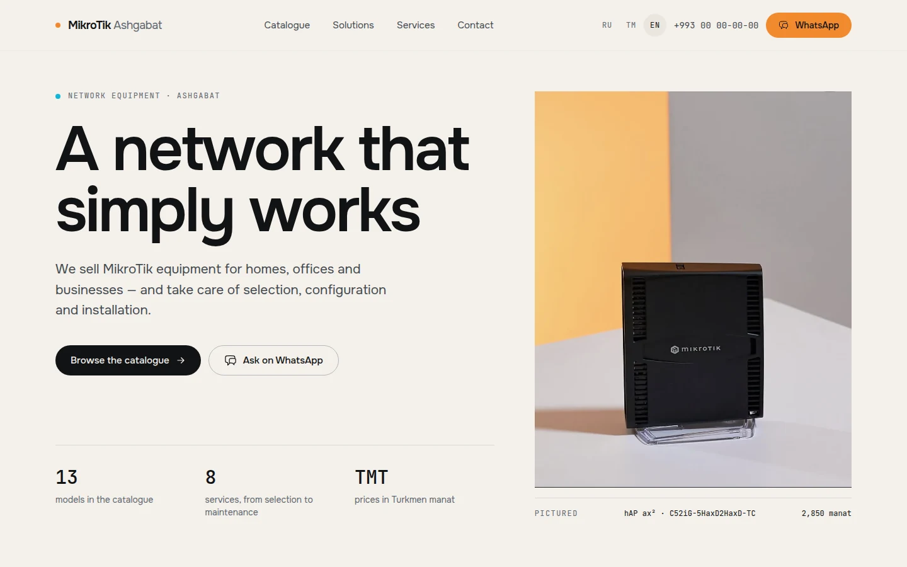
</a>

### [MikroTik Ashgabat — Website Concept](https://github.com/dovlet808/mikrotik-ashgabat-website-concept)

An independent website concept for a network-equipment business: a product catalogue in three languages with search and filters, inquiry forms with spam protection, and an admin panel for products, prices and photos. It ships with 119 automated tests and a self-verifying release builder. It is a concept, not an official or commissioned website.

`PHP 8.3` `Laravel 13` `Filament 5` `Tailwind CSS 4` `Vite 8` `MariaDB`

 

<table>
<tr>
<td width="50%" valign="top">
<a href="https://github.com/dovlet808/majorimanor-site">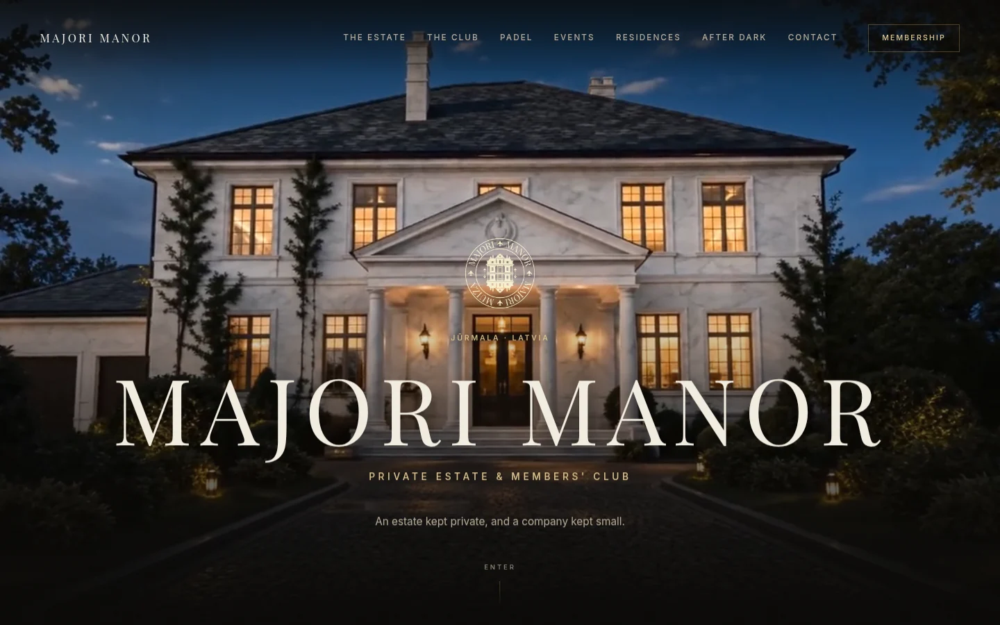</a>
<h3><a href="https://github.com/dovlet808/majorimanor-site">majorimanor-site</a></h3>

The live website of a private members' club in Jūrmala, Latvia: <a href="https://majorimanor.com">majorimanor.com</a>. Eleven cinematic scroll pages in plain PHP with no framework, a token-based design system, and a Python and ffmpeg media pipeline. Owned end to end, from brief to hosting and release.

<code>PHP</code> <code>Vanilla JS</code> <code>GSAP</code> <code>Python</code> <code>ffmpeg</code> <code>DirectAdmin</code>

</td>
<td width="50%" valign="top">
<a href="https://github.com/dovlet808/hostinger-vps-bot"></a>
<h3><a href="https://github.com/dovlet808/hostinger-vps-bot">hostinger-vps-bot</a></h3>

A Telegram bot that automates the full lifecycle of a personal VPS: location change through the Chrome DevTools Protocol, 3x-ui installation over SSH, and VLESS + Reality provisioning. Its <a href="https://github.com/dovlet808/hostinger-vps-bot/blob/main/DEBUGGING.md">DEBUGGING.md</a> documents 13 real bugs and how each one was diagnosed.

<code>Python</code> <code>asyncio</code> <code>paramiko</code> <code>Playwright</code> <code>pytest</code>

</td>
</tr>
</table>

## Tech stack

Technologies I have used in the projects above.

<table>
<tr>
<td valign="top" width="24%"><b>Languages</b></td>
<td>
  
  
  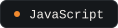
  
  
  
</td>
</tr>
<tr>
<td valign="top" width="24%"><b>Frameworks</b></td>
<td>
  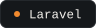
  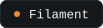
  
</td>
</tr>
<tr>
<td valign="top" width="24%"><b>Frontend</b></td>
<td>
  
  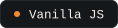
  
  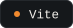
</td>
</tr>
<tr>
<td valign="top" width="24%"><b>Backend</b></td>
<td>
  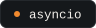
  
  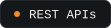
</td>
</tr>
<tr>
<td valign="top" width="24%"><b>Databases</b></td>
<td>
  
</td>
</tr>
<tr>
<td valign="top" width="24%"><b>DevOps and infrastructure</b></td>
<td>
  
  
  
  
  
  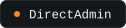
  
  
</td>
</tr>
<tr>
<td valign="top" width="24%"><b>Tools and platforms</b></td>
<td>
  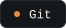
  
  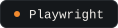
  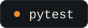
  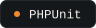
  
  
  
  
</td>
</tr>
</table>

## Current focus

**Building.** Laravel applications with admin panels and multilingual content, and the tooling around them: tests, release checks and browser-driven QA.

**Learning.** Areas I am studying now. They are goals, not experience I claim yet.

  
  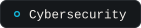
  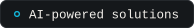

**Open to.** Junior DevOps, SRE, Linux administration and Python automation roles, and freelance work on websites, automation and server setup.

## Contact

- Email: **dovlet808@icloud.com**
- Instagram: [@igdovlet808](https://www.instagram.com/igdovlet808/)
- GitHub: [github.com/dovlet808](https://github.com/dovlet808)

